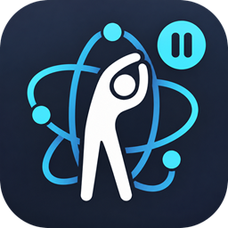
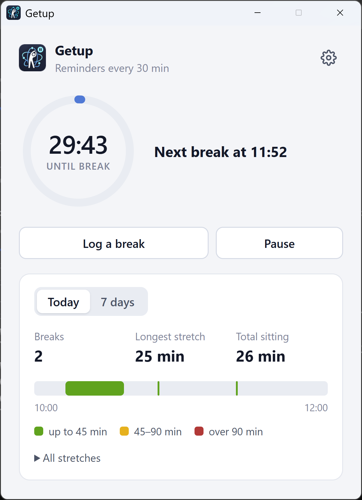

<p align="center">
  
</p>

<h1 align="center">Getup</h1>

<p align="center">
  Fight computer neck: a quiet Windows tray app that gets you up from the desk every 30–45 minutes<br />
  for a short neck-and-shoulders break, and notices when you've already stepped away.
</p>

<p align="center">
  <a href="https://github.com/dsheiko/getup/releases/latest"></a>
  <a href="https://github.com/dsheiko/getup/actions/workflows/test.yml"></a>
  
  <a href="LICENSE"></a>
</p>

<p align="center">
  
</p>

## Why

Hours at a screen with your head pushed forward and shoulders still load the neck far more than it's built for. That's "computer neck" (also called tech neck): stiffness, neck and shoulder pain, headaches, and over the years, wear of the cervical spine. Mine ended up as osteochondrosis, and this is the advice I was given. Every 30–45 minutes:

1. Stand up.
2. Walk around for 1–2 minutes.
3. Slowly turn your head left and right a few times.
4. Relax your shoulders.
5. Move your shoulder blades a few times.
6. Look at something far away.

Don't turn it into a workout. The point is to break up hours of sitting in the same position, before the neck gets stiff. Getup makes sure that actually happens.

> Getup is a reminder, not medical advice. If your neck hurts, see a doctor.

## Features

- **Reminders every 30, 35, 40 or 45 minutes**: a Windows notification plus a small window with the checklist above. The window appears without taking focus, so it never interrupts your typing.
- **Automatic break detection**: 3 minutes away from the mouse and keyboard (90 seconds once a break is due), locking the screen for over a minute, or sleep all count as a break, and the timer starts over.
- **Gentle persistence**: if you ignore a reminder, it comes back after 10 minutes. "In 5 min" snoozes it.
- **Tray icon that shows the countdown**: its edge fills up while you sit. Blue: counting down. Yellow: time to stand up. Red: 15+ minutes overdue. Green: on a break. Grey pause badge: reminders paused.
- **Pause for calls**: pause until you resume, or for 30 min, 1 hour or 2 hours from the tray menu. The countdown stands still and continues where it stopped.
- **Log a break by hand**: "Log a break" starts one, and it ends when you press "End break" or come back to the computer.
- **Daily stats**: number of breaks, your longest stretch without a break, and a timeline of the day (green up to 45 min, yellow 45–90, red over 90). A 7-day view shows the longest stretch for each day.
- **Stays out of the way**: starts with Windows straight to the tray, and has a light and dark theme that follows the system. English and Russian.
- **Private**: no account, no network access. Your history stays on your computer.

## Install

Download **Getup Setup &lt;version&gt;.exe** from the [latest release](https://github.com/dsheiko/getup/releases/latest) and run it. It installs for your user only (no admin rights needed) and starts in the tray.

The installer isn't code-signed yet, so Windows SmartScreen may warn about it the first time: choose **More info → Run anyway**.

## Usage

Click the tray icon to open the window, or right-click it for the menu (open, log a break, pause, quit). Settings (the gear icon) has the reminder interval, sound, whether the window pops up, start with Windows, and language.

If you turn off startup in Task Manager or in Windows Settings → Apps → Startup, the setting in Getup turns off too.

### Command-line options

| Option | What it does |
|---|---|
| `--clear-history` | Deletes the break history. Settings and the current countdown are kept. If Getup is already running, it clears its history and shows the window. |
| `--interval=<minutes>` | Overrides the reminder interval (fractions allowed), for testing. Also available as the `GETUP_INTERVAL` environment variable. |
| `--hidden` | Starts in the tray without showing the window. This is how it starts with Windows. |

```powershell
& "$env:LOCALAPPDATA\Programs\getup\Getup.exe" --clear-history
```

## Your data

History and settings are kept in `%APPDATA%\Getup\getup.json`, for the last 60 days. Nothing is sent anywhere.

The app used to be called Stand-up. On the first run after the rename, Getup copies the history and settings from `%APPDATA%\Stand-up\stand-up.json`; the old folder is left as it was and can be deleted.

## Development

Requires [Node.js](https://nodejs.org/) 20 or newer.

```powershell
npm install
npm start          # run from source
npm run debug      # run with a reminder every 5 minutes
npm test           # tests for the break logic
npm run dist       # Windows installer in dist\ (Getup Setup <version>.exe)
.\build.ps1        # the same, behind a TLS-inspecting proxy
```

The break logic lives in [`src/tracker.js`](src/tracker.js) and has no Electron dependencies, so it's tested with plain `node --test`.

<details>
<summary>Notes on Windows integration</summary>

- Windows only shows notifications from an app that has a Start menu shortcut. Electron creates it by itself and names it after the `.exe`, so when run with `npm start` it's called "Electron". Getup gives it its own icon and makes it start Getup, but the name in the notification header stays "Electron". An installed build shows "Getup" everywhere.
- The taskbar button uses Getup's own icon and name either way. If you move the project folder, the shortcut and the startup entry are updated on the next launch.
- The internal Windows IDs (`stand-up.reminder`, `stand-up.window`) are kept from the old name on purpose: with them, a new installer upgrades an existing install, and the startup entry and taskbar pins keep working.

</details>

## License

[ISC](LICENSE) © Dmitry Sheiko
